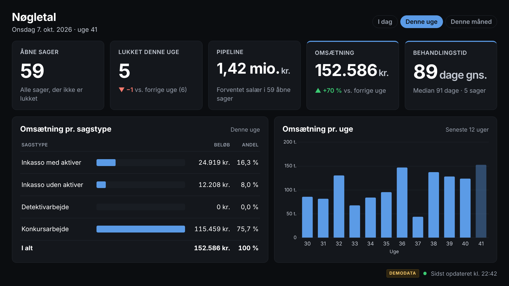
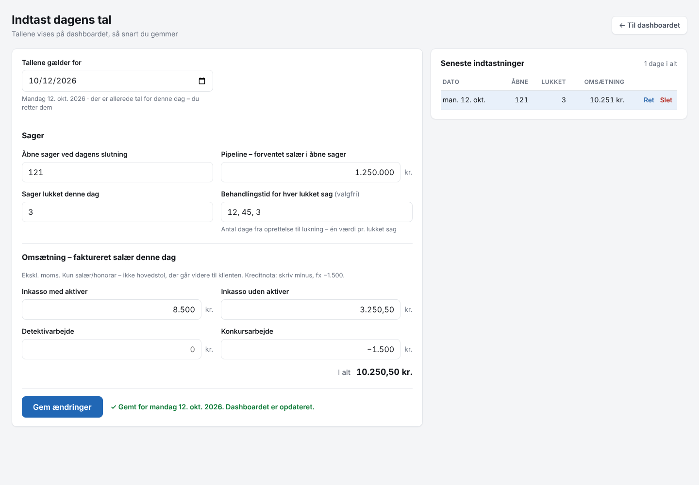

# KPI-dashboard

Internt dashboard med nøgletal for sager og omsætning. Det bruges på laptops og vises permanent på kontorets storskærm.
Det viser **kun aggregerede tal**: ingen navne, CPR-numre, sags- eller fakturanumre.

| Visning | Adresse |
|---|---|
| Laptop (interaktiv) | `http://<server>:8080/` |
| Storskærm / kiosk | `http://<server>:8080/?mode=tv` |
| Indtastning af dagens tal | `http://<server>:8080/indtast` |

> **Status – version 1:** Tallene **tastes ind manuelt hver morgen** på `/indtast` (se [Morgenrutine](#morgenrutine)).
> Uden `.env` kører den på **demodata** med et gult "DEMODATA"-mærke.
> Automatisk kobling til sagssystem og e-conomic afventer godkendt feltmapping. Se [docs/MANGLER-I-SAGSSYSTEMET.md](docs/MANGLER-I-SAGSSYSTEMET.md).



## Indhold

- **KPI'er:** åbne sager, lukket denne uge, pipeline, realiseret omsætning (I dag / Denne uge / Denne måned), behandlingstid (gennemsnit og median) og omsætning pr. sagstype. Præcise definitioner: [docs/KPI-DEFINITIONER.md](docs/KPI-DEFINITIONER.md).
- **Storskærm:** mørkt tema og stor tekst, alt på én skærm uden scroll (1920×1080 og 3840×2160). Skifter automatisk mellem dag, uge og måned og opdaterer uden flimmer.
- **Robust:** fejler en kilde, vises de sidst kendte tal med en diskret advarsel. Ældre end 15 min. markeres også.

## Morgenrutine

Hver morgen (ca. 2 minutter):



1. Åbn `http://<server>:8080/indtast`, eller klik **Indtast tal** på dashboardet.
2. Datoen står allerede på **forrige hverdag**. Om mandagen er det fredag.
3. Udfyld felterne:

| Felt | Hvad skal der stå | Hvor finder jeg det |
|---|---|---|
| Åbne sager ved dagens slutning | Antal sager, der ikke er lukket | Sagssystemet. Forudfyldes med forrige værdi. |
| Pipeline | Forventet salær i alle åbne sager, kr. ekskl. moms | Sagssystemet/eget skøn. Forudfyldes med forrige værdi. |
| Sager lukket denne dag | Antal | Sagssystemet |
| Behandlingstid *(valgfri)* | Dage fra oprettelse til lukning for **hver** lukket sag, fx `12, 45, 3` | Sagssystemet. Uden den vises behandlingstid som "–". |
| Omsætning pr. sagstype | **Salær** faktureret den dag, ekskl. moms. **Ikke** hovedstol. Kreditnota = minus. | e-conomic, fakturaer for dagen |

4. Tryk **Gem tal**. Dashboardet og storskærmen opdateres inden for et minut.

Godt at vide:
- **Tal skrives på dansk:** `1.250.000` eller `3.250,50`. "kr." og mellemrum ignoreres.
- **Ret eller slet:** tidligere dage rettes eller slettes i listen til højre. Glemte hverdage vises som gule knapper.
- **Dashboardet viser "til og med" seneste indtastede dag.** Periodeknapperne hedder derfor fx **Man. 12. okt. / Uge 42 / Oktober** i stedet for "I dag". Mangler gårsdagens tal, vises en gul advarsel.
- **Weekender og helligdage** kan springes over. Der tælles kun de dage, der er tastet.
- **Backup:** tallene ligger i `data/manuel.json`, og forrige version gemmes automatisk som `manuel.json.bak`. Tag jævnligt backup af mappen `data/`. Ved Docker ligger den i volumen `kpi-data`.
- **Kode:** sæt `INDTAST_KODE` i `.env`, så kun dem, der kender koden, kan ændre tallene. Dashboardet kan stadig ses af alle på netværket.

## Arkitektur

```
config/kpi.config.ts      ← alle KPI-definitioner (lukkede statusser, salær-varenumre, fallback m.m.)
shared/                   ← fælles typer + dansk formatering
server/
  providers/              ← datalag: DataProvider = CaseSource + RevenueSource
    demo.ts               ←   demodata
    manuel.ts             ←   manuel indtastning (data/manuel.json)
    sagssystem.ts         ←   sagssystem (read-only) — afventer mapping
    economic.ts           ←   e-conomic REST API (read-only) — afventer mapping
  kpi/                    ← rene, enhedstestede KPI-beregninger
  opdatering.ts           ← henter hvert 3. min., cacher, beholder sidst kendte data
  app.ts                  ← Fastify: /api/dashboard, /api/health, statiske filer
web/                      ← React + Vite + Chart.js (alt bundlet lokalt, ingen CDN)
docs/                     ← KPI-definitioner og åbne punkter
deploy/                   ← systemd-enhed
```

- **Credentials** (e-conomic-tokens, database-URL) ligger kun i `.env` på serveren og sendes aldrig til browseren eller til loggen.
- **Datakilde vælges** med `CASE_SOURCE` (`manuel` | `demo` | `sagssystem`) og `REVENUE_SOURCE` (`manuel` | `demo` | `economic`). Kilderne kan blandes, fx manuelle sagstal + omsætning fra e-conomic, når den er klar.
- **e-conomic:** bogførte fakturaer hentes kun én gang, fordi de ikke kan ændres. Ved hver opdatering hentes kun listen over nye. Ved rate limit (HTTP 429) ventes der med `Retry-After`.

## Krav

- Node.js 22 eller nyere, **eller** Docker med Docker Compose.
- En maskine på kontorets netværk, der altid er tændt.

## Installation

### A) Med Docker Compose (anbefalet)

```bash
git clone <repo> /opt/kpi-dashboard && cd /opt/kpi-dashboard
cp .env.example .env          # ret evt. værdier
docker compose up -d --build  # kører tests, bygger og starter
docker compose logs -f        # se log
```

`restart: unless-stopped` sørger for, at containeren starter igen efter genstart af maskinen (Docker skal selv starte ved boot: `sudo systemctl enable docker`).

Opdatering: `git pull && docker compose up -d --build`.

### B) Direkte med Node.js

```bash
git clone <repo> /opt/kpi-dashboard && cd /opt/kpi-dashboard
npm ci
cp .env.example .env
npm test          # enhedstests
npm run build     # bygger frontend + server til dist/
npm start         # læser .env og starter på port 8080
```

#### Autostart med systemd (Linux)

```bash
sudo useradd --system --home /opt/kpi-dashboard kpi
sudo mkdir -p /opt/kpi-dashboard/data && sudo chown -R kpi:kpi /opt/kpi-dashboard/data
sudo chmod 600 /opt/kpi-dashboard/.env && sudo chown kpi:kpi /opt/kpi-dashboard/.env
sudo cp deploy/kpi-dashboard.service /etc/systemd/system/
sudo systemctl daemon-reload
sudo systemctl enable --now kpi-dashboard
systemctl status kpi-dashboard          # status
journalctl -u kpi-dashboard -f          # log
```

#### Autostart på Windows

Brug fx [pm2](https://pm2.keymetrics.io/) med `pm2-installer`, eller NSSM, og kør `node --env-file=.env dist/server/index.js` fra projektmappen som en tjeneste.

### Udvikling

```bash
npm ci
npm run dev       # backend på :8080 (tsx watch) + Vite på :5173 med hot reload
npm test          # vitest
npm run typecheck
```

## Åbn dashboardet

1. Find serverens lokale IP-adresse (Linux: `hostname -I`, Windows: `ipconfig`), fx `192.168.1.10`. Giv gerne maskinen en fast IP eller et DNS-navn i routeren, fx `dashboard.lan`.
2. **Laptops:** åbn `http://192.168.1.10:8080/` og vælg periode med knapperne øverst. Holder du musen over tal og grafer, vises detaljer.
3. **Storskærm:** åbn `http://192.168.1.10:8080/?mode=tv` i fuldskærm/kiosk, fx:
   ```bash
   chromium --kiosk --noerrdialogs --disable-infobars --incognito "http://192.168.1.10:8080/?mode=tv"
   ```
   Læg kommandoen i autostart på den maskine, der driver skærmen. Slå dvale og pauseskærm fra.

URL-parametre til storskærmen:

| Parameter | Effekt |
|---|---|
| `mode=tv` | Storskærmsvisning |
| `rotation=0` | Slå periodeskift fra (eller fx `rotation=60` for 60 sek.) |
| `periode=dag` / `uge` / `maaned` | Startperiode (fast, hvis `rotation=0`) |

`Esc` forlader tv-visningen.

## Konfiguration

- **`.env`:** server, datakilder, credentials og opdateringsintervaller. Se kommentarer i [.env.example](.env.example).
- **`config/kpi.config.ts`:** KPI-definitioner (kræver `npm run build` og genstart). Se [docs/KPI-DEFINITIONER.md](docs/KPI-DEFINITIONER.md).

## Sikkerhed og persondata

- **Manuel indtastning** gemmer kun aggregerede tal (antal og beløb). Der må **ikke** skrives navne eller sagsnumre i felterne, og felterne tillader kun tal.
- **Kun aggregerede tal.** API'et (`/api/dashboard`) returnerer ingen sags-id'er, navne, CPR-numre, sags- eller fakturanumre. Det er dækket af en test.
- **Ingen persondata i loggen.** Request-logning er slået fra, og loggen indeholder kun antal og fejltyper.
- **Kun internt netværk.** Med `LAN_ONLY=true` (standard) afvises forespørgsler fra offentlige IP-adresser (HTTP 403). Lav **ikke** port-forwarding i routeren, og bind evt. kun til LAN-adressen (`HOST=192.168.1.10`).
- **Kun læseadgang** til kilderne: read-only databasebruger mod et rapporterings-view, og e-conomic-API'et bruges kun med GET.
- **Sikkerhedsheadere:** CSP, `X-Frame-Options: DENY` og `no-referrer` er sat.
- **GDPR:** dashboardet er bygget til internt brug. Skal det senere gøres tilgængeligt udefra (fx hjemmearbejde), skal GDPR-forhold, login og kryptering (HTTPS/VPN) afklares først, selvom der kun vises aggregerede tal.

## Visuel kontrol

```bash
npm run build && npm start &
CHROMIUM_PATH=/sti/til/chromium npm run screenshots   # gemmer billeder i screenshots/
```

Der tages billeder af laptop (lys/mørk), mobil og tv i 1080p og 4K.
